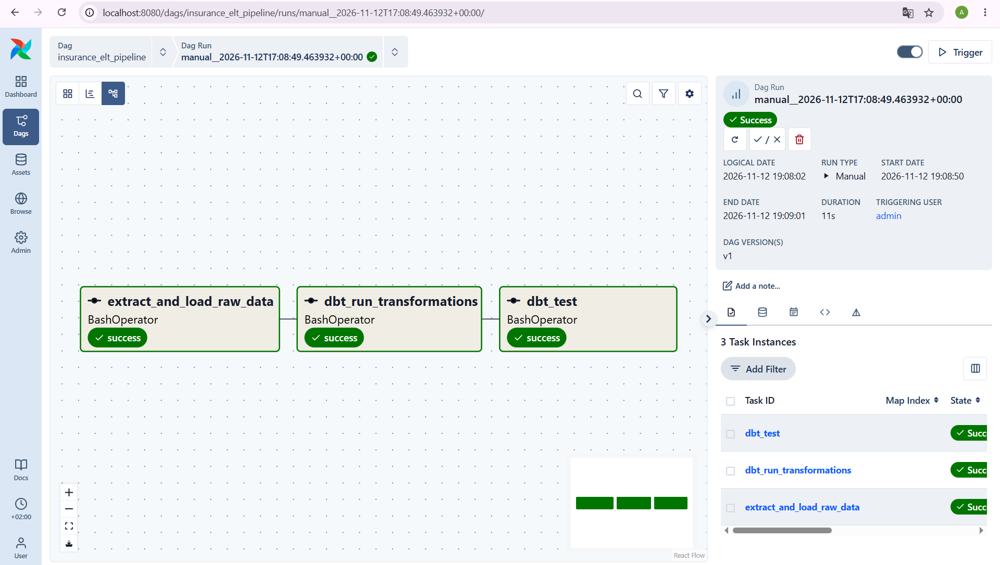

# Modern Data Stack — Insurance Company

**Лабораторна робота №1**

**Дисципліна:** Технології сховищ даних  
**Варіант №8:** Страхова компанія

## Мета роботи

Створити локальне сховище даних PostgreSQL за допомогою Docker, згенерувати тестові дані страхової компанії та завантажити їх у Raw-шар сховища.

## Використані технології

- Python — генерація та завантаження даних.
- Faker — створення тестових даних.
- Pandas — обробка таблиць.
- PyArrow — збереження даних у форматі Parquet.
- PostgreSQL — зберігання даних.
- Docker Compose — запуск бази даних.
- SQLAlchemy — підключення Python до PostgreSQL.
- Git — контроль версій.

## Структура даних

У проєкті створено п'ять таблиць:

| Таблиця | Кількість записів |
|---|---:|
| policy_holders | 500 |
| insurance_plans | 5 |
| agents | 30 |
| policies_sold | 3000 |
| claims | 1000 |

## Архітектура проєкту

Python (Faker, Pandas) → Parquet (Data Lake) → PostgreSQL (Raw Layer)

## Порядок запуску

1. Запустити PostgreSQL командою `docker compose up -d`.
2. Створити віртуальне середовище Python.
3. Встановити залежності з `requirements.txt`.
4. Запустити `data_generator.py`.
5. Запустити `load_to_dwh.py`.
6. Перевірити таблиці у схемі `raw` бази `insurance_dwh`.

## Результат

Створено локальне сховище даних страхової компанії. Згенеровано п'ять наборів даних, збережено їх у форматі Parquet та завантажено до PostgreSQL.

## Лабораторна робота №3. Оркестрація та Data Quality Gates

У межах лабораторної роботи налаштовано Apache Airflow 3.4.0 для автоматизації обробки даних страхової компанії (варіант №8).

Створено DAG `insurance_elt_pipeline`, який складається з трьох послідовних завдань:

1. `extract_and_load_raw_data` — генерація даних і завантаження п'яти таблиць до схеми `raw` PostgreSQL.
2. `dbt_run_transformations` — виконання трансформацій та побудова 10 аналітичних моделей.
3. `dbt_test` — перевірка якості та цілісності даних за допомогою 12 тестів dbt.

DAG налаштовано на щоденний запуск. Під час перевірки всі три завдання завершилися успішно. Загальна тривалість виконання конвеєра становила 11 секунд.

### Результат виконання

